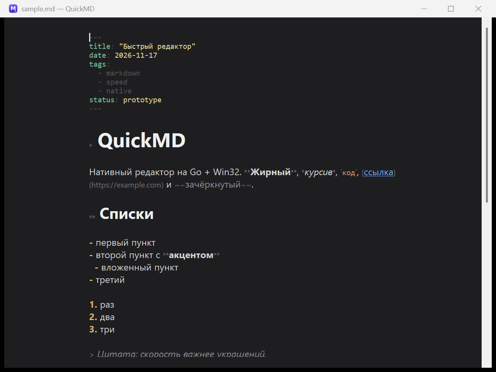

<p align="center">
  
</p>

<h1 align="center">QuickMD</h1>

<p align="center">
  A fast native Markdown editor for Windows — one small Go binary, no Electron, no browser.
</p>

<p align="center">
  
</p>

## Why

Markdown editors are usually Electron apps that take seconds to open. QuickMD is a
single ~2 MB Win32 executable written in Go: the window is ready in **~130 ms**.

## Features

- One pane, MarkText-style: the Markdown source is painted inline — big headings,
  bold/italic/underline, monospace code, blue links, dimmed syntax markers.
- YAML front matter rendered as a coloured block.
- Telegram Desktop formatting shortcuts:
  - `Ctrl+B` — bold (`**text**`)
  - `Ctrl+I` — italic (`_text_`)
  - `Ctrl+U` — underline (`__text__`)
  - `Ctrl+Shift+M` — monospace (`` `text` ``)
  - `Ctrl+Shift+X` — strikethrough (`~~text~~`)
  - `Ctrl+Shift+P` — spoiler (`||text||`)
  - With no selection the pair is inserted and the caret lands between the markers;
    pressing the shortcut again removes them.
- `Ctrl+Z` / `Ctrl+Y` — undo and redo. The syntax repaint would poison RichEdit's
  own undo stack, so QuickMD keeps a small text-snapshot undo of its own.
- Autosave ~1 s after the last edit, `Ctrl+S`, save on close, atomic writes.
- Dark theme, DPI-aware, embedded icon, no runtime dependencies.

## Build

Requires Go 1.24+.

```bash
./build.sh
```

The icon is embedded from `icon/quickmd.ico` through the committed
`rsrc_windows_amd64.syso`. To regenerate it:

```bash
go install github.com/akavel/rsrc@latest
rsrc -ico icon/quickmd.ico -arch amd64 -o rsrc_windows_amd64.syso
```

## Usage

```bat
quickmd.exe "D:\notes\post.md"
```

From WSL:

```bash
./quickmd.exe '\\wsl.localhost\Ubuntu-24.04\root\notes\post.md'
```

## BB integration

The editor is wired into the
[bb-plugin-markdown-open](https://github.com/dvygolov/bb-plugin-markdown-open) BB
plugin: any `.md` file opened in BB has a **«Редактировать»** button that launches
QuickMD with the file's Windows path.

## Limitations

- Markers are dimmed, not hidden: this is a styled source view, not a full
  WYSIWYG document model.
- Raw HTML is shown as code — there is no browser engine inside.
- Undo is snapshot-based: a quick burst of typing is undone as one chunk.

## Layout

```
main.go      window, editor pane, autosave, undo, launch
win32.go     Win32 API bindings
markdown.go  Markdown regexes and front matter parsing
style.go     inline styling spans and RichEdit formatting
shortcuts.go Telegram-style formatting hotkeys
icon/        source icon and .ico
build.sh     one-command build
```
